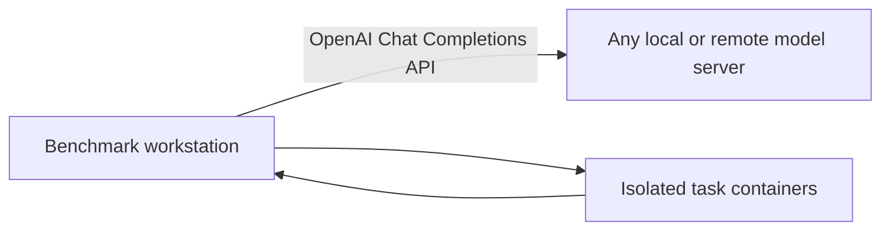

# Edge and Advanced Systems Model Benchmarking

One runner for OpenAI-compatible model endpoints on Edge devices and Advanced/DGX-class systems.

The complete first pass contains up to 10 SWE-bench fixes, 10 Terminal-Bench tasks and 5 reasoning questions. It has no overall wall-clock deadline; each individual task retains a safety timeout.

The harness is backend-independent. Benchmark tasks run locally in Docker while model requests go to the configured API.



## Repository layout

```text
benchmark/                  Coding and API benchmark scripts
benchmark/reasoning.py      Five-question reasoning runner and scorer
benchmark/reasoning-questions.json  Pinned public LiveBench questions
benchmark/report.py         JSON-to-HTML report renderer
benchmark/report-template.html      Standalone report page template
docs/benchmark-guide.md     Start-to-finish benchmark guide
docs/setup-guide.md         Installation, operation and result guide
config.example.env          Shareable workstation configuration template
resultschema.json           Result fields and static task metadata
```

For deployment on a new machine, follow the [Setup and Usage Guide](docs/setup-guide.md). It covers requirements, Docker installation, API validation, execution, results, cleanup and troubleshooting.

## Quick start

### 1. Prepare the model

Start an OpenAI-compatible Chat Completions service for the model being tested.

### 2. Configure the workstation

```bash
cd ai-benchmark
```

Run the script. It suggests Edge Device Benchmark at 32 GiB RAM or below and Advanced Systems Benchmark above 32 GiB; you can override the suggestion. Then choose Performance, Capability, or Complete.

```bash
chmod +x ./benchmark/run.sh
./benchmark/run.sh
```

Advanced Capability runs up to 10 SWE, 10 Terminal and 5 LiveBench tasks. Edge Capability runs the local reasoning, logic, coding, agent and RAG suites. Complete combines performance and capability.

Advanced also offers **Quick test** (menu option 4 or `BENCHMARK_TYPE=quick`): the 4 easiest SWE-bench Verified fixes, the 4 easy Terminal-Bench 2.1 tasks and 2 LiveBench questions, followed by the performance pass, in approximately one hour. Slower models can take longer. Quick results are labelled `benchmark_mode: "quick"`; their pass rates are not comparable with full runs. See [Quick test](docs/benchmark-guide.md#quick-test).

`config.env` is optional. Advanced runs can use:

```env
OPENAI_BASE_URL=http://127.0.0.1:8000/v1
OPENAI_MODEL=/models/example
OPENAI_MODEL_DISPLAY_NAME=Example Model
```

The model ID is sent to the API. The display model name is used in JSON, HTML and result filenames; if omitted, it defaults to the final component of the model ID.

Non-interactive Edge runs use `BENCHMARK_PROFILE=edge`, `EDGE_BASE_URL`, and `EDGE_MODEL`. Set `BENCHMARK_TYPE=performance|tasks|both` for all profiles.

For authenticated endpoints, export `OPENAI_API_KEY` separately; it is never requested or written to results.

### 3. Run preflight

```bash
./benchmark/run.sh --preflight
```

Edge and Advanced Performance preflight check the API and Python runtime. Advanced Capability/Complete additionally validates task IDs, Docker images and the Harbor oracle.

### 4. Run the benchmark

```bash
chmod +x ./benchmark/run.sh
./benchmark/run.sh
```

Results are written under `benchmark-results/<run-id>`. Every runner emits one `<model-name>-result.json` object ready for the web application's importer. JSON includes `benchmark_profile` (`edge` or `advanced`) and `benchmark_mode` (`performance`, `capability`, or `complete`).

The runner does not remove the prepared Docker image cache. Remove it explicitly only when disk space is needed:

```bash
./benchmark/cleanup-docker-cache.sh
```

The reasoning result is a reproducible pinned subset score, not the full official LiveBench leaderboard score.

## Important boundaries

- Task testing requires an x86-64 machine with Docker; performance testing only requires Python and API access.
- Only Chat Completions compatibility is required; `/models`, `/metrics`, SSH and hardware access are not required.
- Never publish API tokens or model weights.
- Never use `docker system prune`; use the scoped cleanup script when disk space is needed.
