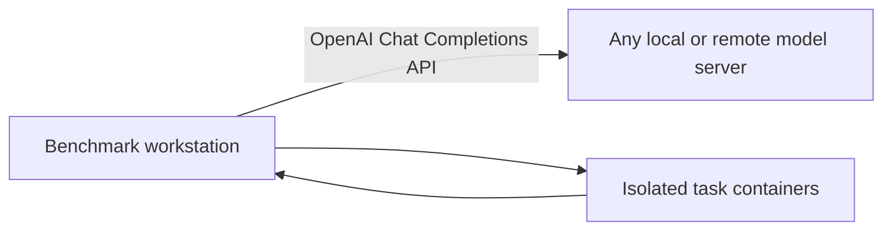

# OpenAI-Compatible Model Benchmarking

Reproducible evaluation of any model exposed through an OpenAI-compatible Chat Completions endpoint, using direct API measurements, SWE-bench Verified, Terminal-Bench 2.1 and a pinned five-question LiveBench reasoning subset.

The complete first pass contains up to 10 SWE-bench fixes, 10 Terminal-Bench tasks and 5 reasoning questions. It has no overall wall-clock deadline; each individual task retains a safety timeout.

The harness is backend-independent. Benchmark tasks run locally in Docker while model requests go to the configured API.



## Repository layout

```text
benchmark/                  Coding and API benchmark scripts
benchmark/reasoning.py      Five-question reasoning runner and scorer
benchmark/reasoning-questions.json  Pinned public LiveBench questions
benchmark/report.py         JSON-to-HTML report renderer
benchmark/report-template.html      Standalone report page template
docs/benchmark-guide.md     Start-to-finish benchmark guide
docs/setup-guide.md         Installation, operation and result guide
config.example.env          Shareable workstation configuration template
resultschema.json           Result fields and static task metadata
```

For deployment on a new machine, follow the [Setup and Usage Guide](docs/setup-guide.md). It covers requirements, Docker installation, API validation, execution, results, cleanup and troubleshooting.

## Quick start

### 1. Prepare the model endpoint

Start any OpenAI-compatible Chat Completions service.

### 2. Configure the workstation

```bash
cd ai-benchmark
```

Run the script and enter the API URL, model ID and benchmark type. The URL may end in `/v1` or `/v1/chat/completions`; the runner normalizes both.

```bash
chmod +x ./benchmark/run.sh
./benchmark/run.sh
```

Choose `1` for performance only, `2` for up to 10 SWE, 10 Terminal and 5 LiveBench tasks, or `3` to run the selected tasks followed by performance measurements. Performance is the default.

`config.env` is optional and may contain only defaults for those same two prompts:

```env
OPENAI_BASE_URL=http://127.0.0.1:8000/v1
OPENAI_MODEL=/models/example
```

For authenticated endpoints, export `OPENAI_API_KEY` separately; it is never requested or written to results.

### 3. Run preflight

```bash
./benchmark/run.sh --preflight
```

Performance preflight checks the API and local Python runtime. Task preflight additionally installs the pinned tools, validates task IDs, prepares Docker images and runs a Harbor oracle smoke test; run it with `BENCHMARK_TYPE=tasks ./benchmark/run.sh --preflight`.

### 4. Run the benchmark

```bash
chmod +x ./benchmark/run.sh
./benchmark/run.sh
```

Live pass/fail progress is printed to the terminal and `run.log`. After completion, the result directory contains `<model-name>-result.json` and a standalone `<model-name>-result.html` report that can be opened directly in a browser.

The runner does not remove the prepared Docker image cache. Remove it explicitly only when disk space is needed:

```bash
./benchmark/cleanup-docker-cache.sh
```

The reasoning result is a reproducible pinned subset score, not the full official LiveBench leaderboard score.

## Important boundaries

- Task testing requires an x86-64 machine with Docker; performance testing only requires Python and API access.
- Only Chat Completions compatibility is required; `/models`, `/metrics`, SSH and hardware access are not required.
- Never publish API tokens or model weights.
- Never use `docker system prune`; use the scoped cleanup script when disk space is needed.
