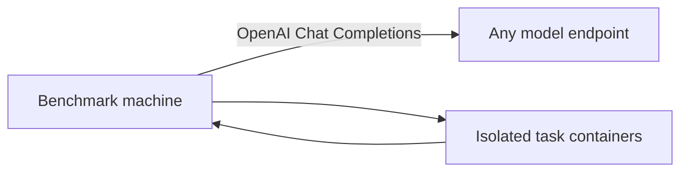
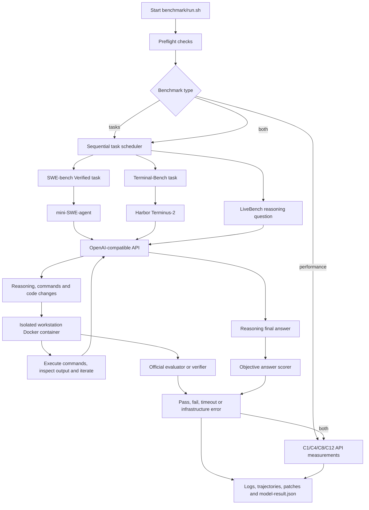

# OpenAI-Compatible Model Benchmark Guide

This document explains how any OpenAI-compatible model endpoint is benchmarked from initial validation through final scoring. It covers three measurements:

1. **Model performance:** workstation-observed prompt-processing and answer-generation speed.
2. **Coding ability:** real repository and terminal tasks using SWE-bench Verified and Terminal-Bench 2.1.
3. **General reasoning:** five pinned medium-to-hard questions from the public LiveBench reasoning dataset.

## 1. Architecture

The model may run locally, on DGX, in a cloud service or on any other backend. The harness needs only an OpenAI-compatible `/chat/completions` endpoint.



The benchmark tools and task containers run on an x86-64 machine with Docker. No SSH or hardware access to the model server is used.

| Item | Configuration |
|---|---|
| API | Entered when `run.sh` starts |
| Coding benchmark model | Entered when `run.sh` starts |
| Model runtime | Any OpenAI-compatible backend |
| Workstation runtime | Docker, Python and Bash |
| Execution policy | One task at a time |

## 2. Benchmark files

| File | Purpose |
|---|---|
| [`benchmark/run.sh`](../benchmark/run.sh) | Preflight, task execution, monitoring and live JSON generation |
| [`benchmark/result.py`](../benchmark/result.py) | Builds the UI-ready result JSON from raw artifacts |
| [`benchmark/report.py`](../benchmark/report.py) | Renders the final result JSON as a standalone HTML page |
| [`benchmark/report-template.html`](../benchmark/report-template.html) | Static report layout, styles and tables |
| [`benchmark/mini-swe.yaml`](../benchmark/mini-swe.yaml) | mini-SWE-agent model configuration |
| [`benchmark/requirements.txt`](../benchmark/requirements.txt) | Pinned benchmark packages |
| [`benchmark/measure-api.py`](../benchmark/measure-api.py) | Direct prefill, single-request decode and aggregate concurrent throughput measurement |
| [`benchmark/reasoning.py`](../benchmark/reasoning.py) | Direct API runner and objective reasoning scorer |
| [`benchmark/reasoning-questions.json`](../benchmark/reasoning-questions.json) | Five pinned LiveBench questions and ground truths |
| [`config.example.env`](../config.example.env) | Optional endpoint and model defaults |
| `benchmark-results/<UTC run ID>/` | Timestamped raw artifacts, live status and final JSON result |

Pinned tools:

```text
mini-swe-agent 2.4.5
harbor          0.20.0
swebench        4.1.0
```

Official projects:

- [SWE-bench](https://github.com/SWE-bench/SWE-bench)
- [SWE-bench Verified dataset](https://huggingface.co/datasets/princeton-nlp/SWE-bench_Verified)
- [Terminal-Bench 2](https://github.com/harbor-framework/terminal-bench-2)
- [Harbor](https://github.com/harbor-framework/harbor)
- [LiveBench](https://github.com/LiveBench/LiveBench)
- [LiveBench reasoning dataset](https://huggingface.co/datasets/livebench/reasoning)

## 3. How the benchmark works

The runner creates isolated Docker environments for the test cases. The agent sends prompts to the configured endpoint, executes returned commands in the task container, and submits the final change to the official grader.



### SWE-bench Verified

SWE-bench uses real GitHub repository issues. mini-SWE-agent must inspect the repository, edit the code and submit a patch. The official SWE-bench evaluator applies the patch and runs the repository tests. A task passes only when the official report marks the issue resolved.

Tasks used:

```text
astropy__astropy-12907
django__django-11141
pydata__xarray-3677
sympy__sympy-15599
matplotlib__matplotlib-23299
scikit-learn__scikit-learn-14087
sphinx-doc__sphinx-11445
pytest-dev__pytest-10051
pylint-dev__pylint-6528
mwaskom__seaborn-3187
```

### Terminal-Bench 2.1

Harbor starts a clean task container and Terminus-2 asks the configured model how to solve the terminal problem. The model can run commands, inspect results and make corrections. The official task verifier returns a reward; reward `1` is counted as a pass.

Tasks used:

```text
kv-store-grpc
configure-git-webserver
nginx-request-logging
query-optimize
db-wal-recovery
git-multibranch
git-leak-recovery
build-cython-ext
custom-memory-heap-crash
cancel-async-tasks
```

### LiveBench reasoning subset

The reasoning stage sends the selected questions directly to the same OpenAI-compatible endpoint and scores each final answer against objective ground truth. It does not need Docker or another model service.

| Question | Difficulty | Capability |
|---|---|---|
| `livebench-zebra_puzzle-26` | Level 18 | Constraint satisfaction |
| `livebench-zebra_puzzle-30` | Level 20 | Multi-constraint deduction |
| `livebench-zebra_puzzle-46` | Level 20 | Large multi-attribute deduction |
| `livebench-spatial-88` | Hard | 3D cutting and spatial reasoning |
| `livebench-spatial-90` | Hard | Geometry and spatial positioning |

Question IDs, release dates, prompts and answers are pinned in the repository. The resulting percentage is a subset score and must not be presented as a full official LiveBench score.

## 4. Time and safety limits

| Limit | Value |
|---|---:|
| SWE agent / official grader | 25 / 10 minutes |
| Terminal task | 20 minutes |
| Reasoning question | 10 minutes |
| Minimum free disk before preflight | 75 GiB |
| Minimum free disk before each task | 20 GiB |

Every configured task is attempted once. The runner does not repeat completed cases and has no overall wall-clock deadline. Per-task safety limits prevent one broken case from hanging the entire run.

### Quick test

`BENCHMARK_TYPE=quick` (menu option 4, Advanced only) is an approximately one-hour check of every suite plus the performance pass. Slower reasoning models can take longer. It uses the easiest tasks that run in this harness, in a 4:4:2 ratio:

| Suite | Tasks | Fixed limits |
|---|---|---:|
| SWE-bench Verified (`<15 min fix`) | `django__django-11179`, `sympy__sympy-16886`, `pytest-dev__pytest-7982`, `pallets__flask-5014` | 10 min agent + 5 min grader |
| Terminal-Bench 2.1 (`easy`) | `fix-git`, `prove-plus-comm`, `kv-store-grpc`, `nginx-request-logging` | 8 min |
| LiveBench | `livebench-zebra_puzzle-26`, `livebench-spatial-88` | 7 min; 8,192 output tokens |

Every task in a suite gets the same limits, so its position cannot change its score. SWE grading has a separate allowance and uses the dataset cached by preflight; grader failures are infrastructure errors, not model timeouts. Harbor retains time for its verifier inside the Terminal cap. Quick preflight needs 30 GiB free and runs the Harbor oracle on `fix-git`.

Results carry `benchmark_mode: "quick"` and the HTML report says so. Because the tasks are easier and the limits shorter, quick pass rates must not be compared with full-run pass rates. Quick results made before the `kv-store-grpc` and `nginx-request-logging` selection are also not directly comparable.

Preflight containers use automatic removal where supported, and Harbor tasks are requested with deletion enabled. Harbor preparation reports progress every 60 seconds and stops a stalled task preparation after 5 minutes or oracle check after 10 minutes. Prepared images remain cached for later runs. The runner never performs broad Docker pruning; use `./benchmark/cleanup-docker-cache.sh` when the benchmark cache is no longer needed. Setup, dataset checks and image downloads happen during preflight and are excluded from the timed benchmark.

## 5. Workstation prerequisites

Run the harness on an x86-64 machine with Docker; the model endpoint may run anywhere.

Required commands:

```text
curl docker timeout awk python3
```

On Ubuntu, install the missing workstation utilities with:

```bash
sudo apt update
sudo apt install -y git curl python3-venv
```

Docker must already be installed, running and accessible to the current workstation user.

## 6. Configure the model endpoint

No configuration file is required. Start the runner and enter the API URL and exact model ID when prompted. Both a base URL ending in `/v1` and a full URL ending in `/v1/chat/completions` are accepted.

```bash
./benchmark/run.sh
OpenAI API base URL: http://127.0.0.1:8000/v1
Model ID: /models/example
```

To provide defaults while retaining the prompts, create `config.env` containing only:

```env
OPENAI_BASE_URL=http://127.0.0.1:8000/v1
OPENAI_MODEL=/models/example
```

For non-interactive execution, export those two variables. An authenticated service may receive its key through the standard `OPENAI_API_KEY` environment variable; the runner never prompts for or records it.

Preflight verifies the endpoint with a short completion. `/models` is queried only when available and is not required.

```bash
curl --fail --show-error "$OPENAI_BASE_URL/chat/completions" \
  -H 'Content-Type: application/json' \
  -d "{\"model\":\"$OPENAI_MODEL\",\"messages\":[{\"role\":\"user\",\"content\":\"Reply with READY only.\"}],\"max_tokens\":32,\"temperature\":0}" \
  | python3 -m json.tool
```

## 7. Run preflight separately

Preflight checks the following before the benchmark clock starts:

- Working OpenAI-compatible chat completion
- Docker availability and x86-64 architecture
- At least 75 GiB free workstation disk
- Selected SWE-bench task IDs and difficulty values
- Required SWE-bench and Terminal-Bench Docker images
- Harbor oracle smoke test
- Reasoning question-file and scorer self-test

Run it with:

```bash
cd ai-benchmark
./benchmark/run.sh --preflight
```

The Hugging Face unauthenticated-request warning is harmless. `HF_TOKEN` is optional and only provides higher download rate limits.

## 8. Start the complete benchmark

Run directly:

```bash
cd ai-benchmark
./benchmark/run.sh
```

The runner asks for the API base URL, model ID and benchmark type. Choose `1` for performance, `2` for tasks, `3` for both or `4` for the [quick test](#quick-test). Task counts default to 10 SWE, 10 Terminal and 5 LiveBench tasks; the quick test uses its own fixed 4/4/2 set.

The lines below are task-start announcements, not errors. The displayed value is the maximum allowed time:

```text
[2026-09-01T08:00:00Z] [START 01/25] [SWE] astropy__astropy-12907 | limit=1500s | log=primary/swe/astropy__astropy-12907/agent.log
[2026-09-01T08:01:00Z] [RUNNING 01/25] [SWE] astropy__astropy-12907 | elapsed=60s | log=primary/swe/astropy__astropy-12907/agent.log
[2026-09-01T08:02:22Z] [PASS 01/25] [SWE] astropy__astropy-12907 | duration=142s | exit=0/0 | done=1 pass=1 fail=0 timeout=0 error=0
```

Diagnostic lines explain why a task ended the way it did:

| Line | Meaning |
|---|---|
| `[DETAIL] [SWE] … agent_status=…` | mini-SWE-agent exit status, such as `Submitted`, `RepeatedFormatError` (the model kept breaking the action format) or `LimitsExceeded` |
| `[DETAIL] [REASONING] …` | Outcome, score, `finish_reason` and token usage; `finish_reason: "length"` means the answer hit the output token limit |
| `[DETAIL] … last lines of <log>` | The last 5 log lines, printed after every timeout or infrastructure error |
| `[SUMMARY] [SWE] pass=…` | Per-suite totals after each suite and again at the end |
| `[QUICK] …` | Quick-test plan and fixed per-stage limits |

## 9. Monitor a running benchmark

From another workstation terminal:

```bash
cd ai-benchmark
RUN_DIR=$(ls -dt benchmark-results/20* | head -1)
tail -f "$RUN_DIR/run.log"
```

The main log shows task transitions. Detailed agent and grader logs are stored inside the individual task directories:

```bash
find "$RUN_DIR" -type f \
  \( -name agent.log -o -name harbor.log -o -name evaluator.log \) \
  -print
```

Display results already recorded:

```bash
column -t -s $'\t' "$RUN_DIR/task-results.tsv"
python3 -m json.tool "$RUN_DIR"/*-result.json
```

SWE and Terminal tasks can take several minutes because each one includes model reasoning, terminal iterations, repository tests and an official grading phase. This is different from a simple API throughput request.

## 10. Stop behavior

Normally, allow the runner to finish all selected cases. The model result JSON is refreshed after every task, so an interrupted run still has its completed outcomes and an `interrupted` status.

Interrupted runs keep their artifacts. Every invocation starts a new result directory and runs the selected cases from the beginning.

The runner preserves downloaded benchmark images. Remove those cached images explicitly only when disk space is needed:

```bash
./benchmark/cleanup-docker-cache.sh
```

Do not run `docker system prune`.

Both `--preflight` and a full run keep prepared images for the next run.

## 11. Result directory

Every invocation creates:

```text
benchmark-results/<UTC timestamp>/
├── preflight/                 API, task and image checks
├── primary/                   First SWE, Terminal and reasoning attempts
│   └── reasoning/             Answers, usage and objective scores
├── task-results.tsv           Per-task duration and outcome
├── run.log                    Main runner output
├── <model-name>-result.json   Live and final machine-readable result
└── <model-name>-result.html   Standalone human-readable report
```

Task directories also preserve agent logs, model trajectories, submitted patches, official evaluator output and verifier rewards.

The HTML report is generated automatically after the final JSON. It embeds the JSON data and can be opened directly without a web server:

```bash
xdg-open benchmark-results/<UTC timestamp>/<model-name>-result.html
```

To render an existing result manually:

```bash
python3 benchmark/report.py --input benchmark-results/<run>/<model-name>-result.json
```

## 12. How scores are calculated

```text
SWE pass rate      = resolved SWE tasks / attempted SWE tasks × 100
Terminal pass rate = reward-1 Terminal tasks / attempted Terminal tasks × 100
Reasoning pass rate = fully correct reasoning questions / attempted reasoning questions × 100
Reasoning mean score = sum of objective question scores / scored questions × 100
Engineering pass rate = passed SWE and Terminal tasks / attempted engineering tasks × 100
```

Infrastructure errors, timeouts and malformed tool responses are reported separately so they are not silently presented as model-quality failures.

## 13. Direct model-performance measurement

With `performance`, the runner skips all tasks and measures speed directly; with `both`, it measures speed after the selected tasks. Each level gets one warm-up followed by three uncached measured batches with unique nonces. Aggregate throughput is measured sequentially at C4, C8 and C12 by default. Medians and all raw samples are embedded in `<model-name>-result.json`; no separate performance files are created.

Long-context example:

```bash
python3 benchmark/measure-api.py \
  --endpoint "$OPENAI_BASE_URL" \
  --model "$OPENAI_MODEL" \
  --runs 3 \
  --warmup-runs 1 \
  --prompt-lines 800 \
  --max-tokens 8
```

Short-context example:

```bash
python3 benchmark/measure-api.py \
  --endpoint "$OPENAI_BASE_URL" \
  --model "$OPENAI_MODEL" \
  --runs 3 \
  --warmup-runs 1 \
  --prompt-lines 0 \
  --max-tokens 512
```

Concurrent aggregate example:

```bash
python3 benchmark/measure-api.py \
  --endpoint "$OPENAI_BASE_URL" \
  --model "$OPENAI_MODEL" \
  --runs 3 \
  --warmup-runs 1 \
  --prompt-lines 0 \
  --max-tokens 512 \
  --concurrency 4
```

Definitions:

```text
Approximate prefill TPS = prompt tokens / time to first generated token
Decode TPS              = generated tokens after the first / remaining stream time
Aggregate generation TPS = total completion tokens across concurrent requests / batch wall time
Effective per-user TPS     = aggregate generation TPS / submitted concurrency
```

Set `OPENAI_AGGREGATE_CONCURRENCIES` to a space-separated list before starting the runner to override the default `4 8 12` levels.

TTFT is reported as the mean of the short-prompt single-request runs and separately as the mean across every request at C4, C8 and C12 using the same request shape. Per-request concurrent TTFT samples remain in the result JSON.

These are workstation-observed measurements and include API/network overhead. Active-request decode TPS excludes time spent waiting for the first token; use effective per-user TPS for the end-to-end concurrent-user view.

Only measure one served model at a time. The supplied model ID must be accepted by the endpoint.

## 14. Completion checklist

- [ ] The configured endpoint accepts the supplied model ID
- [ ] Short chat completion succeeds
- [ ] Preflight finishes successfully
- [ ] All selected primary tasks are attempted
- [ ] Official SWE and Terminal graders run
- [ ] All selected reasoning questions are attempted and objectively scored
- [ ] `task-results.tsv` contains per-task outcomes
- [ ] Prefill, single-request decode and aggregate concurrent values are embedded in the result JSON
- [ ] `<model-name>-result.json` has `run.status` set to `completed`
- [ ] `<model-name>-result.html` opens and shows the same result
- [ ] Transient benchmark containers are removed; cached images are retained unless cleanup is requested
- [ ] Model failures are separated from infrastructure failures
