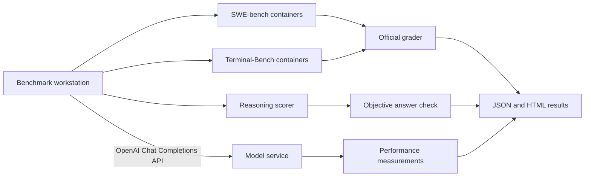

# AI Benchmark — Setup and Usage Guide

This guide covers the Advanced API-based workflow. For local Edge benchmarking, select Edge in `benchmark/run.sh` and provide the GGUF model path and `llama-completion` path; see the [compact Edge run guide](../README.md#edge-local-files). Edge defaults to 8 threads / 4096 context and needs no API server or Docker.

## 1. Overview

The benchmark evaluates any model exposed through an OpenAI-compatible Chat Completions API. Benchmark tools and Docker environments run on the local workstation; the model may run locally, on a GPU server, a DGX cluster or a cloud service.

The complete suite contains:

| Suite | Maximum | Purpose |
|---|---:|---|
| SWE-bench Verified | 10 tasks | Repository-level source-code bug fixing |
| Terminal-Bench 2.1 | 10 tasks | Linux, services, databases, Git, builds and concurrency |
| LiveBench subset | 5 questions | Medium-to-hard objective reasoning |

It also measures approximate prefill TPS, single-request decode TPS, aggregate TPS and time to first token (TTFT) for one request and concurrent C4/C8/C12 batches.



> **Screenshot 1 — Architecture**  
> Suggested file: `docs/screenshots/01-architecture.png`.

## 2. System requirements

The table below applies to `tasks` mode. `performance` mode only needs Python 3, curl, network access to the endpoint and enough disk for its small result files.

| Resource | Minimum | Recommended |
|---|---:|---:|
| Architecture | x86-64 | x86-64 |
| CPU | Docker-capable | 8 or more cores |
| RAM | Docker-capable | 16 GB or more |
| Free disk at startup | 75 GiB | 120 GB or more |
| Free disk before each task | 20 GiB | 40 GB or more |
| Operating system | Linux | Ubuntu 22.04/24.04 LTS |

Internet access is required for GitHub, PyPI, Hugging Face, Docker registries, Harbor and the model API. The model server may use any hardware or operating system; no SSH or direct host access is required.

Verify the machine:

```bash
uname -m
nproc
free -h
df -h .
. /etc/os-release && printf '%s %s\n' "$NAME" "$VERSION"
```

`uname -m` must print `x86_64`.

> **Screenshot 2 — System requirements**  
> Add the architecture, CPU, RAM, disk and OS output. Suggested file: `docs/screenshots/02-system-requirements.png`.

## 3. Install required software

### Base packages

On Ubuntu:

```bash
sudo apt update
sudo apt install -y git curl python3 python3-venv coreutils gawk ca-certificates
```

Verify:

```bash
git --version
curl --version
python3 --version
timeout --version | head -1
awk --version | head -1
```

In `tasks` mode, the runner automatically creates `benchmark/.venv` and installs:

- `mini-swe-agent==2.4.5`
- `harbor==0.20.0`
- `swebench==4.1.0`

Do not install these packages globally.

### Docker Engine

If `docker info` already succeeds, skip this installation.

Install Docker from its official Ubuntu repository:

```bash
sudo apt update
sudo apt install -y ca-certificates curl
sudo install -m 0755 -d /etc/apt/keyrings
sudo curl -fsSL https://download.docker.com/linux/ubuntu/gpg -o /etc/apt/keyrings/docker.asc
sudo chmod a+r /etc/apt/keyrings/docker.asc

sudo tee /etc/apt/sources.list.d/docker.sources >/dev/null <<EOF
Types: deb
URIs: https://download.docker.com/linux/ubuntu
Suites: $(. /etc/os-release && echo "${UBUNTU_CODENAME:-$VERSION_CODENAME}")
Components: stable
Architectures: $(dpkg --print-architecture)
Signed-By: /etc/apt/keyrings/docker.asc
EOF

sudo apt update
sudo apt install -y docker-ce docker-ce-cli containerd.io docker-buildx-plugin docker-compose-plugin
sudo usermod -aG docker "$USER"
newgrp docker
```

Verify Docker:

```bash
docker version
docker info
docker run --rm hello-world
```

Logging out and back in may be required after changing group membership. Docker group membership grants root-level privileges.

> **Screenshot 3 — Docker**  
> Add a successful `docker version` and `hello-world` run. Suggested file: `docs/screenshots/03-docker.png`.

## 4. Clone the repository

```bash
git clone https://github.com/siliconwaves-dev/ai-benchmark.git
cd ai-benchmark
```

Verify the main files:

```bash
ls benchmark/run.sh benchmark/requirements.txt resultschema.json
git status --short
```

Update an existing clone:

```bash
git pull --ff-only
```

> **Screenshot 4 — Repository**  
> Add the completed clone and file listing. Suggested file: `docs/screenshots/04-repository.png`.

## 5. Model API requirements

The endpoint must support:

- `POST /v1/chat/completions`;
- the supplied model ID;
- tool/function calling for agent tasks;
- streaming Server-Sent Events;
- `stream_options: {"include_usage": true}` with token usage; and
- sufficient input and output context for repository work.

The performance test also sends `ignore_eos`. If the endpoint rejects this option, task evaluation may work while performance measurement fails.

`GET /v1/models` is optional. A 404 from `/models` is acceptable when Chat Completions works.

### Verify the API

```bash
export OPENAI_BASE_URL="https://ai.example.com/v1"
export OPENAI_MODEL="/models/example-model"
export OPENAI_API_KEY="dummy"
```

For an authenticated endpoint, read the key without adding it to shell history:

```bash
read -rsp 'OpenAI API key: ' OPENAI_API_KEY
echo
export OPENAI_API_KEY
```

Test Chat Completions:

```bash
curl --fail --show-error "$OPENAI_BASE_URL/chat/completions" \
  -H "Authorization: Bearer $OPENAI_API_KEY" \
  -H 'Content-Type: application/json' \
  --data @- <<JSON | python3 -m json.tool
{
  "model": "$OPENAI_MODEL",
  "messages": [
    {"role": "user", "content": "Reply with READY only."}
  ],
  "max_tokens": 32,
  "temperature": 0
}
JSON
```

Continue only when the response contains a non-empty `choices` array.

> **Screenshot 5 — API response**  
> Add the successful response after redacting secrets. Suggested file: `docs/screenshots/05-api-response.png`.

## 6. Configuration

No configuration file is required. `./benchmark/run.sh` asks for:

1. API URL ending in `/v1` or `/v1/chat/completions`;
2. model ID;
3. benchmark type: `1` performance, `2` tasks or `3` both.

`performance` skips all tasks and immediately measures model speed. `tasks` asks for SWE-bench (0–10), Terminal-Bench (0–10) and LiveBench (0–5) counts. `both` runs those selected tasks and then measures performance.

To save the endpoint and model defaults:

```bash
cp config.example.env config.env
```

Edit `config.env`:

```env
OPENAI_BASE_URL=https://ai.example.com/v1
OPENAI_MODEL=/models/example-model
```

`config.env` is ignored by Git. Keep API keys out of this file and export `OPENAI_API_KEY` only when required.

## 7. Run preflight

```bash
./benchmark/run.sh --preflight
```

The default performance preflight checks local tools, self-tests and the API. Task preflight also checks Docker, architecture, disk, task IDs, images and a Harbor oracle task:

```bash
BENCHMARK_TYPE=tasks ./benchmark/run.sh --preflight
```

A successful preflight ends with:

```text
Preflight passed. Free disk: <number> GiB
```

The first preflight can take a long time because it downloads packages, datasets and images. Later runs reuse the cache. A normal benchmark performs preflight automatically.

> **Screenshot 6 — Preflight**  
> Add the successful preflight output. Suggested file: `docs/screenshots/06-preflight.png`.

## 8. Run the benchmark

### Small verification run

```bash
./benchmark/run.sh
```

Enter one task from each suite:

```text
OpenAI API URL: https://ai.example.com/v1
Model ID: /models/example-model
Benchmark type: tasks
SWE-bench task count: 1
Terminal-Bench task count: 1
LiveBench task count: 1
```

This verifies API access, agent execution, official grading and report generation.

### Quick test run

Select benchmark type `4` (or set `BENCHMARK_TYPE=quick`) to run 4 SWE, 4 Terminal and 2 LiveBench easiest tasks followed by the performance pass, in approximately one hour. Slower models can take longer. Task selection and time limits are fixed; see [Quick test](benchmark-guide.md#quick-test). Quick results are labelled `benchmark_mode: "quick"` and are not comparable with full runs.

```bash
BENCHMARK_TYPE=quick ./benchmark/run.sh --preflight
BENCHMARK_TYPE=quick ./benchmark/run.sh
```

### Complete task run

Run the same command, select `tasks`, then select 10 SWE, 10 Terminal and 5 LiveBench tasks.

Tasks run sequentially. There is no overall time limit.

| Stage | Limit |
|---|---:|
| SWE-bench task | 25 minutes |
| Terminal-Bench task | 20 minutes |
| LiveBench question | 10 minutes |

Keep the terminal open until completion. Ctrl+C stops the run and records an interrupted JSON result when task data exists.

> **Screenshot 7 — Benchmark run**  
> Add the selected model, task counts and live progress. Suggested file: `docs/screenshots/07-benchmark-run.png`.

### Non-interactive run

```bash
OPENAI_BASE_URL="https://ai.example.com/v1" \
OPENAI_MODEL="/models/example-model" \
BENCHMARK_TYPE=tasks \
SWE_TASK_COUNT=10 \
TERMINAL_TASK_COUNT=10 \
REASONING_TASK_COUNT=5 \
./benchmark/run.sh
```

Export a real API key separately before running this command.

## 9. Monitor progress

The terminal reports task start, a heartbeat every 60 seconds and the outcome:

```text
[START 01/3] [SWE] astropy__astropy-12907 | limit=1500s
[RUNNING 01/3] [SWE] astropy__astropy-12907 | elapsed=300s
[PASS 01/3] [SWE] astropy__astropy-12907 | duration=693s
```

From another terminal:

```bash
cd ai-benchmark
RUN_DIR=$(find benchmark-results -mindepth 1 -maxdepth 1 -type d | sort | tail -1)
tail -f "$RUN_DIR/run.log"
```

View the task ledger:

```bash
cat "$RUN_DIR/task-results.tsv"
```

The JSON result is refreshed after every completed task.

## 10. How scoring works

### SWE-bench Verified

The official repository state is loaded in Docker. mini-SWE-agent gives the issue and repository tools to the model. The resulting patch is graded with the official tests.

### Terminal-Bench 2.1

Harbor prepares an isolated task container. The model executes terminal commands, and the official verifier assigns the reward. Reward `1` is pass; a lower reward is fail.

### LiveBench subset

Five pinned public questions are stored in `benchmark/reasoning-questions.json`. The local scorer checks answers against objective ground truth. This is a reproducible subset score, not a complete LiveBench leaderboard result.

## 11. Results

Each run creates:

```text
benchmark-results/
└── YYYYMMDDTHHMMSSZ/
    ├── preflight/
    ├── primary/
    │   ├── swe/
    │   ├── terminal/
    │   └── reasoning/
    ├── run.log
    ├── task-results.tsv
    ├── <model-name>-result.json
    └── <model-name>-result.html
```

| Artifact | Purpose |
|---|---|
| `run.log` | Complete execution log |
| `task-results.tsv` | Task durations and outcomes |
| `preflight/` | API, environment and image checks |
| `primary/swe/` | Agent trajectories, patches and grader output |
| `primary/terminal/` | Harbor logs and rewards |
| `primary/reasoning/` | Model answers and scores |
| `*-result.json` | Structured result for integrations and UIs |
| `*-result.html` | Standalone report for viewing and sharing |

Open the HTML report:

```bash
xdg-open benchmark-results/<run-id>/<model-name>-result.html
```

If JSON exists but HTML is missing:

```bash
python3 benchmark/report.py \
  --input benchmark-results/<run-id>/<model-name>-result.json
```

> **Screenshot 8 — Results**  
> Add the result folder and HTML overview. Suggested files: `docs/screenshots/08-result-folder.png` and `docs/screenshots/09-html-report.png`.

## 12. Interpret results

### Outcomes

| Outcome | Meaning |
|---|---|
| `pass` | Official or objective grader accepted the result |
| `fail` | Grader rejected the completed result |
| `timeout` | Task exceeded its safety limit |
| `infra_error` | API, Docker, dataset or harness prevented grading |
| `interrupted` | The overall run was stopped |

Pass rate is `passed tasks / attempted tasks × 100`. Infrastructure errors are not model-quality failures and should be rerun after fixing the environment.

### JSON sections

| Section | Content |
|---|---|
| `run` | ID, status, timestamps and duration |
| `progress` | Completed, passed, failed and current task |
| `selection` | Selected suite counts |
| `model` | Model ID and context settings |
| `environment` | API, architecture and tool versions |
| `quality` | Per-suite pass rates and reasoning score |
| `model_service` | Prefill, decode, aggregate and TTFT metrics |
| `hardware` | Optional serving-host telemetry |
| `tasks` | Summary, source, image, outcome and artifact per task |
| `artifacts` | Result and log locations |

Maximum VRAM and swap are normally `null` because a generic OpenAI API does not expose model-host telemetry.

## 13. Performance metrics

The `performance` run performs one warm-up, then three uncached measured runs at each level. It stores the median and every measured sample in the result JSON.

| Metric | Calculation | Meaning |
|---|---|---|
| Approximate prefill TPS | prompt tokens / time to first token | Long-prompt API processing speed, including network and scheduling |
| Decode TPS | generated tokens after first token / decode time | Single-request generation speed |
| Aggregate TPS | total concurrent completion tokens / batch time | Multi-request service throughput |
| Effective per-user TPS | aggregate TPS / submitted concurrency | End-to-end throughput available per submitted user |
| Single-request mean TTFT | request start to first generated token | Mean latency for the same short-prompt workload used by the concurrent tests |
| Concurrent mean TTFT | mean request start-to-first-token time | Mean response latency across every request at C4, C8 or C12 |

Aggregate throughput is measured sequentially at C4, C8 and C12 by default and each TPS value is reported with its concurrency. Measurements include API and network overhead. Keep model settings, endpoint, request shapes and network path consistent when comparing results.

## 14. Optional tuning

No token-limit exports are needed for a normal Advanced run. `run.sh` defaults to 65536 output tokens and, when `/v1/models` reports a context length, reserves output space and caps automatic input at 262144 tokens. The variables below are optional overrides for models with different limits.

| Variable | Default | Purpose |
|---|---:|---|
| `OPENAI_MODEL_MAX_INPUT_TOKENS` | Up to 262144 after reserving output; 131072 fallback if context is unavailable | Input limit advertised to agents; at least 16K for SWE/Terminal tasks |
| `OPENAI_MODEL_MAX_OUTPUT_TOKENS` | `65536` | Maximum agent output; at least 4K for capability tasks |
| `OPENAI_REASONING_EFFORT` | empty | Optional reasoning setting |
| `OPENAI_PERFORMANCE_TIMEOUT_SECONDS` | `1800` | Performance-stage timeout |
| `OPENAI_PERFORMANCE_RUNS` | `3` | Measurement repetitions |
| `OPENAI_PERFORMANCE_WARMUP_RUNS` | `1` | Unrecorded warm-ups before each performance level |
| `OPENAI_PREFILL_PROMPT_LINES` | `800` | Prefill prompt size |
| `OPENAI_PREFILL_MAX_TOKENS` | `8` | Prefill output size |
| `OPENAI_DECODE_MAX_TOKENS` | `512` | Decode output size |
| `OPENAI_AGGREGATE_CONCURRENCIES` | `4 8 12` | Space-separated aggregate parallel-request levels |

Capability preflight rejects smaller token limits before preparing task images. A 4K input/1K output setting can cause repeated context summarization and truncated answers, so its pass rate is not comparable with an 8K-output run. Harbor's agent timeout is scaled to fit inside the runner's 20-minute task cap; a Harbor `AgentTimeoutError` is reported as a timeout, not a model failure. When `/v1/models` provides a `root` field, the result also records the backend model behind an API alias at preflight time.

Preflight rejects an explicit input/output combination above the model's advertised context. Models with 65536 tokens of context or less require a smaller output-limit override.

## 15. Stop and cleanup

Ctrl+C stops a run. There is no resume mode; rerunning creates a new timestamped directory.

The runner does not use `docker system prune` or delete unrelated Docker resources. Prepared benchmark images remain cached.

Inspect usage:

```bash
docker system df
df -h .
```

Remove only the benchmark cache when no longer needed:

```bash
./benchmark/cleanup-docker-cache.sh
```

This removes the pulled `swebench/sweb.eval.*` images, any locally built `sweb.base|env|eval.*` images and the Harbor task cache. Quick and full runs use different SWE images, so running both adds about 12 GB of quick-test images; clean up first if the 75 GiB full-run preflight check fails.

## 16. Troubleshooting

### API returns 404

Enter either `https://ai.example.com/v1` or `https://ai.example.com/v1/chat/completions`. A 404 from `/models` alone is not fatal.

### Connection refused or timed out

Confirm the service is running, the URL and port are correct, DNS resolves and the endpoint is reachable from the workstation.

### Docker permission denied

Run `docker info` and `id`. Log out and back in after adding the user to the Docker group.

### Low disk space

Run `df -h .`, `docker system df` and, when cached benchmark images are no longer needed, `./benchmark/cleanup-docker-cache.sh`.

### Hugging Face authentication warning

The warning is harmless unless rate limits are reached. If necessary, export an `HF_TOKEN` in the current shell.

### A task appears stuck

Check `run.log` for `[RUNNING]`. The individual timeout eventually records an outcome and continues.

### Performance stage fails

Verify SSE streaming, `stream_options.include_usage`, token usage fields and support for `ignore_eos`.

## 17. Security

- Never commit API keys, tokens, private endpoint credentials or model weights.
- Redact credentials and private data from screenshots.
- Treat Docker group membership as root-level access.
- Review logs and patches before sharing results.
- Keep unauthenticated endpoints inside the intended network.
- Use the scoped cleanup script instead of broad prune commands.

## 18. Completion checklist

- [ ] Architecture is `x86_64`.
- [ ] At least 75 GiB is free; 120 GB is recommended.
- [ ] `docker info` works without a password prompt.
- [ ] Manual Chat Completions returns `choices`.
- [ ] Preflight reports `Preflight passed`.
- [ ] A 1 + 1 + 1 verification run completes.
- [ ] JSON, HTML, logs and raw task artifacts exist.
- [ ] HTML and JSON show matching outcomes.
- [ ] No credentials are included in Git or screenshots.

## 19. Official references

- [Docker Engine on Ubuntu](https://docs.docker.com/engine/install/ubuntu/)
- [Docker Linux post-installation](https://docs.docker.com/engine/install/linux-postinstall/)
- [SWE-bench](https://github.com/SWE-bench/SWE-bench)
- [SWE-bench Verified dataset](https://huggingface.co/datasets/princeton-nlp/SWE-bench_Verified)
- [mini-SWE-agent](https://github.com/SWE-agent/mini-swe-agent)
- [Terminal-Bench 2](https://github.com/harbor-framework/terminal-bench-2)
- [Harbor evaluations](https://www.harborframework.com/docs/run-jobs/run-evals)
- [LiveBench](https://github.com/LiveBench/LiveBench)

## Quick command reference

```bash
git clone https://github.com/siliconwaves-dev/ai-benchmark.git
cd ai-benchmark
export OPENAI_API_KEY="dummy"
./benchmark/run.sh --preflight
./benchmark/run.sh
```

Start with 1 SWE, 1 Terminal and 1 LiveBench task. After it succeeds, select 10, 10 and 5 for a complete run.
